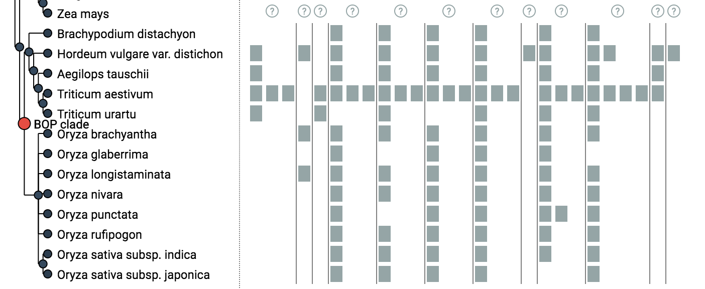

# iHam

iHam ("interactive HOG Analysis Method") is an interactive viewer for the evolutionary history of a gene family organised as hierarchical orthologous groups (HOGs). It has two panels: a species tree, in which you pick the taxonomic range to focus on, and a matrix that places the extant genes by species (rows) and by HOG at the selected level (columns).



The tree-guided matrix helps to (i) delineate orthologous groups at a given taxonomic range, (ii) identify duplication and loss events along the species tree, (iii) gauge the cumulative effect of duplications and losses on gene repertoires, and (iv) spot potential problems in genome assembly, annotation or orthology inference (e.g. losses concentrated on terminal branches, or implausible species coverage). Genes can be coloured by protein length, GC content, number of exons or function similarity; low-coverage HOGs can be hidden; clades can be collapsed. iHam is used to display HOGs in the [OMA browser](https://omabrowser.org).

Input: HOGs in [OrthoXML](https://orthoxml.org) (plain, or OMA's augmented flavour), the species tree in newick or phyloXML, and optionally gene family data in JSON.

> **Version 2** is a rewrite as a Vue 3 component and `<i-ham>` web component. iHam 1.x (TnT/d3 v3 based, `iHam()` chainable API) is on the `master` branch and released as `v1.x`.

## How to cite iHam

*Clément-Marie Train, Miguel Pignatelli, Adrian Altenhoff, Christophe Dessimoz; iHam and pyHam: visualizing and processing hierarchical orthologous groups, Bioinformatics, bty994, https://doi.org/10.1093/bioinformatics/bty994*

## Usage

### In a Vue 3 application

```sh
npm install iham
```

```vue
<script setup>
import { ref } from "vue";
import { IHam } from "iham";
import "iham/style.css";

const level = ref("Homininae");
</script>

<template>
  <IHam
    orthoxml-url="/oma/hog/HOG:F0782425.2c.7a/orthoxml/augmented/"
    species-tree-url="/All/speciestree.nwk"
    fam-data-url="/oma/hogdata/HUMAN31534/json"
    query-hog="HOG:F0782425.2c.7a_207598"
    preset="oma"
    v-model:level="level"
    @hogs-removed="(removed) => console.log(removed)"
  />
</template>
```

### In any web page

```html
<script type="module" src="https://cdn.jsdelivr.net/npm/iham@2/dist/element/iham-element.js"></script>
<!-- or, as a classic script: .../dist/element/iham-element.iife.js -->

<i-ham
  orthoxml-url="https://omabrowser.org/oma/hog/HOG:F0782425.2c.7a/orthoxml/augmented/"
  species-tree-url="https://omabrowser.org/All/speciestree.nwk"
  level="Homininae"
  preset="oma"
  base-url="https://omabrowser.org"
></i-ham>

<script>
  const viewer = document.querySelector("i-ham");
  viewer.addEventListener("node-selected", (e) => console.log(e.detail[0].name));
  // objects and functions are set as properties:
  // viewer.famData = [...]; viewer.geneColors = (gene, id) => "#c00";
</script>
```

The element bundles Vue and renders into a shadow root, so page styles don't leak in or out.

## Properties

Attributes are the kebab-case form of the property names.

| Property | Type | Default | Description |
|---|---|---|---|
| `orthoxml` / `orthoxmlUrl` | string | | OrthoXML content, or a URL to load it from |
| `speciesTree` / `speciesTreeUrl` | string | | species tree (newick or phyloXML), or a URL |
| `famData` / `famDataUrl` | array / string | | gene family data (`[{id, protid, xrefid, sequence_length, gc_content, nr_exons, similarity}]`) |
| `augmented` | boolean | auto | parse as OMA augmented OrthoXML (detected automatically) |
| `queryHog` | string | | HOG id whose members are highlighted (OMA: `<hog id>_<taxid>`) |
| `queryGene` | number | | gene id to highlight |
| `level` | string | root | taxonomic level to open at (`v-model:level`) |
| `coverageThreshold` | number | `0` | hide HOGs present in fewer than this % of species (`v-model`) |
| `colorScheme` | `query` \| `sequence_length` \| `gc_content` \| `nr_exons` \| `similarity` | `query` | gene colouring (`v-model`) |
| `geneColors` | `(gene, id) => color` | | custom colouring, overrides `colorScheme` |
| `tooltipTrigger` | `click` \| `hover` | `click` | how gene info is opened |
| `toolbar` | `open` \| `collapsed` \| `hidden` | `open` | built-in toolbar; `collapsed` puts the settings behind a *Settings* button (the colour legend and the hidden-HOG notice stay visible) |
| `preset` | `oma` \| `none` | `none` | `oma` enables OMA browser links and API lookups (GO terms, HOG ids) |
| `baseUrl` | string | `""` | base URL for the `oma` preset (relative by default) |
| `links`, `api` | object | | override individual link/API URL templates, e.g. `{ hogViewer: "/hog/{hogId}/{level}" }`; placeholders `{hogId}`, `{level}`, `{protId}`, `{xref}`, `{geneId}` |
| `treeWidth` | number | `330` | width of the tree panel (px) |
| `rowHeight` | number | `20` | height of a species row (px) |
| `height` | string | `80vh` | maximum height of the scrollable viewer |
| `showInternalLabels` | boolean | `true` | label the selected internal node |

## Events

| Event | Payload | |
|---|---|---|
| `loaded` | `{species, genes, augmented}` | data parsed |
| `node-selected` | `{name, id, isLeaf, species}` | a tree node was selected (hover or programmatically) |
| `update:level` | level name | for `v-model:level` |
| `hogs-removed` | HOG indices | columns hidden by the coverage threshold changed |
| `update:coverageThreshold`, `update:colorScheme` | value | for `v-model` |
| `error` | `Error` | loading or parsing failed |

On the custom element these are DOM `CustomEvent`s whose `detail` is the array of arguments.

The component also exposes `setLevel(level)`, `freeze(level?)` and `unfreeze()` (Vue template ref). The parsing and layout functions (`parseOrthoXml`, `computeLevelView`, …) are exported from `iham` for use without the UI.

## Development

```sh
npm install
npm run dev        # playground at http://localhost:5173 (proxies /oma, /api, /All to OMA stage; IHAM_OMA_URL to change)
npm test           # unit, component and v1-parity tests (vitest + jsdom)
npm run typecheck
npm run build      # dist/iham.js + iham.css (Vue library), dist/element/* (web component), dist/types
```
